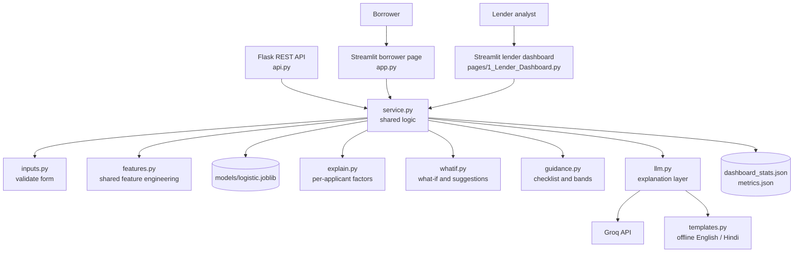
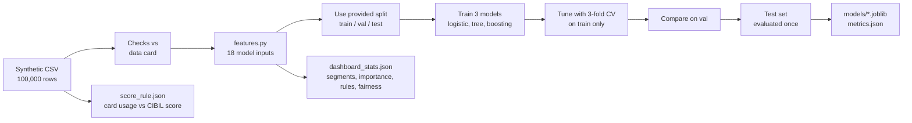
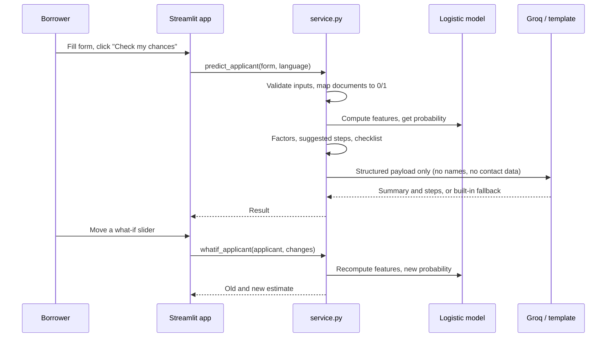
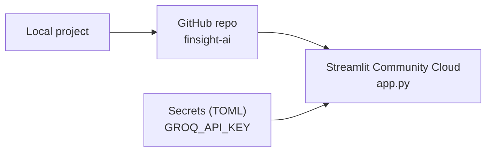

# Architecture and workflow

How FinSight AI is put together and how data flows through it. See the [README](../README.md) for the overview, results and run steps.

> All data is **synthetic**, calibrated to TransUnion CIBIL published aggregates. Estimate only - not financial advice or a lending decision.

## 1. System architecture

One shared logic layer (`service.py`) serves two front doors: the Streamlit pages and the Flask REST API. The Streamlit pages call `service.py` directly, so the demo needs only one process.

| Layer | Files | Role |
|---|---|---|
| Presentation | `app.py`, `pages/1_Lender_Dashboard.py`, `theme.py` | Streamlit UI, Paytm-inspired navy and sky-blue theme |
| API | `api.py` | Thin REST wrapper: `/api/health`, `/api/metrics`, `/api/predict`, `/api/whatif`, `/api/dashboard/summary` |
| Service | `service.py` | `predict_applicant`, `whatif_applicant`, `dashboard_summary` |
| Domain | `inputs.py`, `features.py`, `explain.py`, `whatif.py`, `guidance.py`, `rules.py` | Validation, features, explanation, what-if, checklist, tree rules |
| LLM | `llm.py`, `templates.py` | Grounded rewrite with validation and offline fallback |
| Artifacts | `models/` | Saved models, metrics, dashboard statistics, score rule |
| Training | `finsight_training.ipynb` | Colab notebook that produces everything in `models/` |

## 2. Two workflows

### 2.1 Offline: training (Colab)

Training is done in Google Colab because the laptop is a modest machine (8 GB RAM). The app only loads the saved models.

Discipline kept: the test set is touched once, after tuning, and the ship decision rule (boosting must beat logistic by 0.02 AUC) was fixed before seeing the 100k results.

### 2.2 Online: a borrower request

### 2.3 Deployment

The key lives only in the Streamlit Secrets box and the local `.env`. Both are kept out of the repository.

## 3. Key components

### Feature engineering (`features.py`)
- One function for training **and** serving, so there is no drift.
- Recomputes `foir_current`, `foir_post_loan` and `loan_to_monthly_income` from raw inputs. The interest rate depends on the CIBIL tier: 19 / 15.5 / 13 / 11.5 / 10.75, and 17 for new-to-credit.
- Model inputs: 17 numeric features plus employment type (18 in all). `gender`, `city_tier` and `age` are never inputs, and the training notebook asserts it.

### Model
- Pipeline: median imputation, scaling and one-hot encoding, then logistic regression.
- The same coefficients give the probability, the factor explanations and the what-if.

### Explanations (`explain.py`)
- Contribution = coefficient x scaled value (log-odds push relative to an average applicant).
- The three correlated EMI ratio features are merged into one factor.
- Factors with almost no effect are hidden. New-to-credit applicants never see CIBIL-based factors, because their values are imputed.

### What-if and suggestions (`whatif.py`)
- Copies the applicant, applies the changes, recomputes features and the probability.
- Suggestions search **actionable** features only: card usage, existing EMIs, loan amount, tenure (capped so the loan ends before age 60) and documents.
- A small linear rule (`score_rule.json`) estimates how the CIBIL score moves when card usage changes. It is an assumption fitted on synthetic data and is labelled as such.

### LLM layer (`llm.py`)
- Sees only the structured payload and decides nothing.
- Output is validated: right shape, no promise of approval, and every number must exist in the payload. Failures fall back to `templates.py`.
- Reasons are generated by code. The LLM writes only the summary and next steps.
- Timeouts: 12 s for English, 25 s for Hindi.

### Lender dashboard
- Reads precomputed statistics, so it is fast and works offline.
- Every sentence under a chart is filled in by code from the numbers. The page shows the data-source label and the fairness caveat.

## 4. Design decisions

| Decision | Why |
|---|---|
| Train in Colab, run locally | 8 GB laptop. The saved pipeline contains the preprocessing, so the app needs no separate scaler |
| Ship logistic regression | Boosting gained only 0.0154 AUC, and logistic is explainable end to end |
| Streamlit UI plus thin Flask API | A Flask website with templates and CSS was too heavy for the time. The deck still names Flask + REST, and the API exists |
| Streamlit calls `service.py` directly | One process for the demo, so a stopped API cannot break the screens |
| Template fallback | The demo must work with weak or no internet |
| Reasons built by code | A small free LLM drops factors and mixes languages. Code keeps them exact |
| Pinned scikit-learn 1.6.1 | Pickled models can break across versions |
| Estimates, never decisions | Guardrail, repeated on every page |

## 5. Guardrails

- No fabricated numbers, and synthetic data is always labelled.
- Sensitive attributes are audited on the dashboard but never used by the model.
- No applicant data is stored or logged. Inputs live only in the browser session.
- The LLM sees only the structured payload, and its output is validated.
- Everything important works offline.