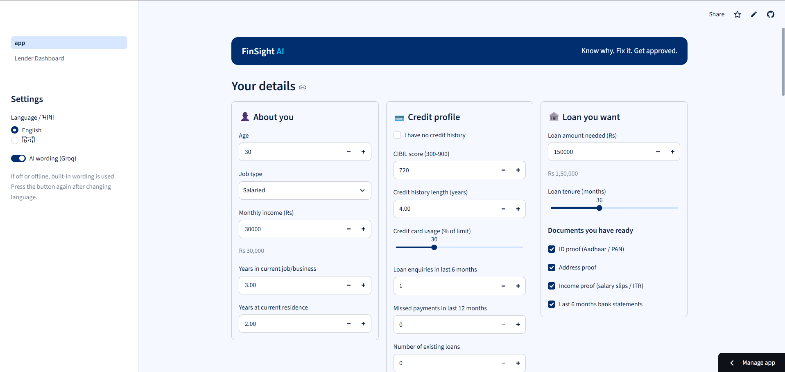
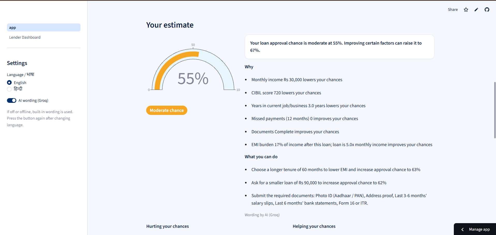
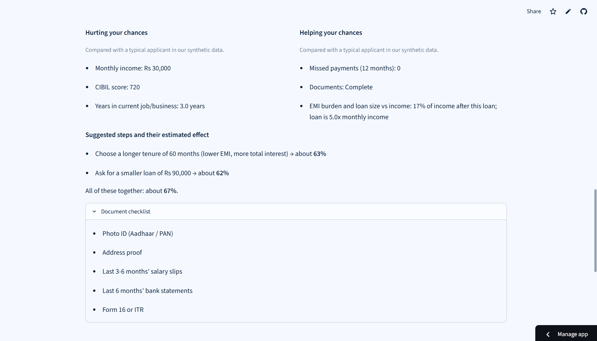
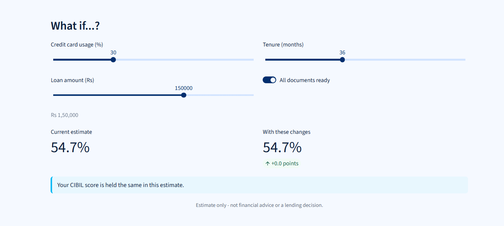
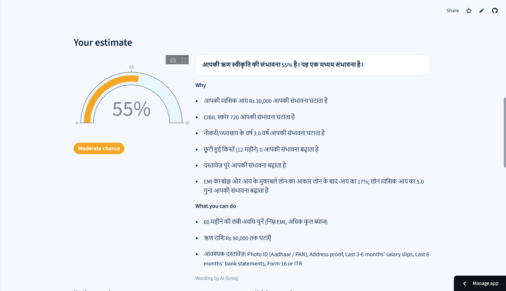
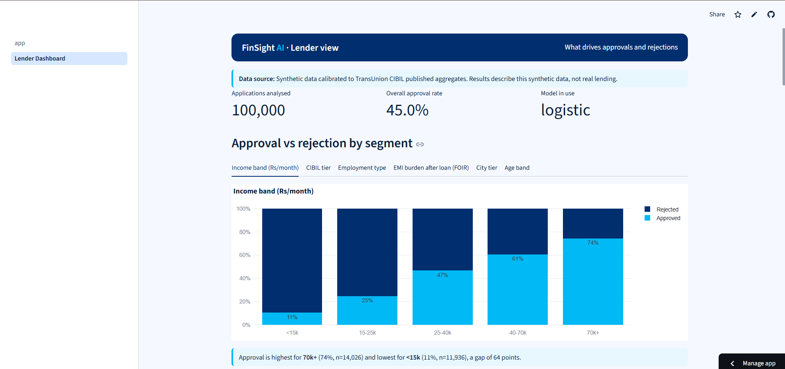
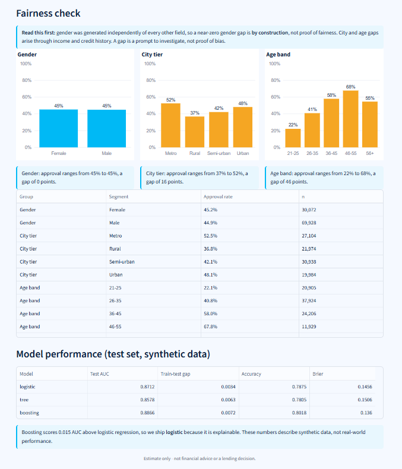

# FinSight AI

**The AI loan copilot: know why, fix it, get approved.**

A prototype for first-time and small borrowers in India. It estimates the chance that a personal-loan application is approved, explains the main factors in plain language (English and Hindi), suggests realistic steps to improve, and lets the borrower see the estimate change live. A second page gives lenders a view of what drives approvals and rejections.

> **Live demo:** `updated soon`
>
> **Estimate only - not financial advice or a lending decision.**
> All numbers come from **synthetic data** (calibrated to TransUnion CIBIL published aggregates). They are not real-world performance.

Built for the **Paytm Build for India AI Hackathon, Pune** (track: AI-Powered Financial Journeys, theme: Lending). Team **FinSight AI**, lead **Amit Kumar**.

---

## The problem

First-time and small borrowers are often rejected without understanding why, or give up because eligibility rules and documents feel confusing. Lenders, in turn, lack a clear view of what drives their rejections.

## What it does

**Borrower side** (`app.py`)

| Feature | What the user gets |
|---|---|
| **Predict** | An estimated approval probability from a logistic regression model, shown as a gauge with a band (Good / Moderate / Low chance) |
| **Explain** | The main factors hurting and helping, with the user's own values, in simple English or Hindi |
| **Guide** | 2-3 realistic steps to improve the odds, each with its estimated effect, plus a document checklist for salaried or self-employed applicants |
| **What-if** | Sliders for card usage, loan amount, tenure, existing EMIs and documents. The estimate updates live |

**Lender side** (`pages/1_Lender_Dashboard.py`)

- Approval vs rejection by income band, CIBIL tier, employment type, EMI burden (FOIR), city tier and age band
- Permutation importance (what drives the decision)
- Distribution of primary rejection reasons
- Plain-language rules from a small decision tree
- Fairness check across gender, city tier and age band, with an explicit caveat
- A computed one-sentence inference under every chart, and a visible data-source label

## Screenshots

**1. The form**



**2. The estimate**



**3. Factors, suggested steps and document checklist**



**4. Live what-if**



**5. Hindi**



**6. Lender dashboard**



**7. Fairness check and decision-tree rules**



---

## The data (synthetic)

- **100,000** synthetic Indian personal-loan applications, 30 columns, seed 42. No real customers.
- **Calibrated to published aggregates** from the TransUnion CIBIL Credit Market Indicator (Sep 2026): risk-tier shares, applicant age and city-tier mix, the 13% new-to-credit share, and early-delinquency rates.
- **Everything else is an assumption:** income distribution, the ~45% overall approval rate, loan sizes, and the approval rules themselves (loosely based on public eligibility criteria and softened for NBFC/fintech lenders).
- The CIBIL report belongs to TransUnion CIBIL. Only its aggregate statistics were used, for calibration.
- The dataset files are **not** in this repository.

## Models and results

All results are on the held-out **test set (15,001 rows)** of the synthetic data, using the provided `train / val / test` split (70 / 15 / 15). Models were tuned with cross-validation on the training set only. The test set was evaluated once.

| Model | Test ROC-AUC | Train-test gap | Accuracy | Precision | Recall | Brier |
|---|---|---|---|---|---|---|
| **Logistic regression (shipped)** | **0.8712** | 0.0034 | 0.7875 | 0.7737 | 0.7456 | 0.1456 |
| Decision tree (depth 5) | 0.8578 | 0.0063 | 0.7805 | 0.7350 | 0.8005 | 0.1506 |
| Gradient boosting (benchmark) | 0.8866 | 0.0072 | 0.8018 | 0.7748 | 0.7885 | 0.1360 |

**Why logistic regression is shipped.** Boosting gains only **0.0154 AUC**. The threshold (0.02) was set before seeing the 100k results. Logistic regression is explainable: the same coefficients give the probability, the per-applicant factors and the what-if. Boosting stays as the accuracy benchmark, and the decision tree is used for readable rules.

**Calibration.** The predicted and observed approval rates agree within about 0.03 in every probability decile on the test set, so the probabilities shown to users are reasonably calibrated *on this synthetic data*.

**Feature groups** (cross-validated AUC lost when a group is removed, training set, all-features baseline 0.8745):

| Group removed | AUC lost |
|---|---|
| Credit history and behaviour | 0.0919 |
| Documents | 0.0113 |
| Income and loan terms | 0.0071 |
| EMI / loan-to-income ratios | 0.0024 |
| Employment | 0.0007 |

Every group helps, so all 18 features are kept. Employment adds little to the score.

**Features not used as model inputs:** `gender`, `city_tier` and `age` (fairness columns, audited only), `primary_rejection_reason` and `ever_30dpd_6m` (leakage), `cibil_tier`, `proposed_emi`, `assumed_interest_rate_pct`, and bookkeeping columns. Age is used only for the rule "loan must finish before age 60" when suggesting tenures.

## How it works

```
Streamlit pages (app.py, pages/)          Flask API (api.py)
            \                                   /
             \--------->  service.py  <--------/
                              |
        inputs.py  features.py  explain.py  whatif.py  guidance.py  llm.py
                              |
                  models/logistic.joblib  (+ tree, metrics, dashboard stats)
```

- **One feature function.** `features.py` computes proposed EMI, FOIR and loan-to-income ratios from raw inputs, so serving uses exactly the same code as training.
- **Explanations.** Per-applicant contribution = coefficient x scaled value (log-odds push relative to an average applicant). The three correlated ratio features are merged into one "EMI burden and loan size" factor so signs do not mislead. Factors with almost no effect are hidden.
- **What-if.** The applicant is copied, the changes applied, the engineered features recomputed, and the probability recalculated. When card usage changes, the CIBIL score is estimated to move using a simple linear rule fitted on the synthetic data (`models/score_rule.json`). It is an assumption, not a real bureau rule, and the page says so.
- **Suggestions.** A small search over **actionable** features only (card usage, existing EMIs, loan amount, tenure, documents) finds the smallest change that lifts the estimate. Age, history and past missed payments are never suggested.
- **Dashboard.** Reads precomputed statistics from `models/dashboard_stats.json`, produced from the 100k dataset in the training notebook. Every sentence under a chart is filled in by code from those numbers.

### The LLM layer

The LLM **decides nothing**. It only rewrites structured results into simple language.

- One provider-agnostic function, `generate_explanation(payload)`, in `llm.py`. Groq is used (model set by `GROQ_MODEL`).
- The model sees **only** a structured payload (probability, band, factors, suggested actions, checklist). It never sees names or contact details.
- Output is **validated**: right shape, no promise of approval, and every number must appear in the payload. Anything that fails falls back to the built-in text.
- Reasons are generated by code, not by the LLM. The LLM writes the summary and next steps.
- **Offline-safe:** without a key, without internet or on any error, a pure-Python template produces the same keys in English and Hindi.

## Guardrails

- No fabricated numbers. Every figure comes from code that ran, and the data is always labelled synthetic.
- **Sensitive attributes** (gender, city tier, age) are never model inputs.
- No applicant data is stored, and raw inputs are not logged.
- The app gives an estimate, never a decision or a promise.
- "Estimate only - not financial advice or a lending decision." is shown on every page.

### Fairness check: how to read it

| Group | Approval-rate gap (max - min) |
|---|---|
| Gender | 0.003 |
| City tier | 0.157 |
| Age band | 0.456 |

Gender was generated independently of every other field, so a near-zero gender gap is **by construction, not evidence of fairness**. City and age gaps arise through income, employment history and credit history in the data, and age is also affected by the assumed retirement-age rule. A gap is a prompt to investigate, not proof of bias.

## REST API

The Flask API wraps the same `service.py` functions the Streamlit pages use.

| Method | Path | Purpose |
|---|---|---|
| GET | `/api/health` | Status check |
| GET | `/api/metrics` | Model metrics from `models/metrics.json` |
| POST | `/api/predict` | Applicant form in; probability, band, factors, steps, explanation and checklist out |
| POST | `/api/whatif` | `{applicant, changes}` in; old and new probability out |
| GET | `/api/dashboard/summary` | Dashboard statistics and metrics |

Example (Windows PowerShell):

```powershell
$body = @{ language="en"; use_llm=$false; form=@{
  age=30; employment_type="salaried"; monthly_income=30000; employment_years=3; residence_years=2
  no_credit_history=$false; cibil_score=720; credit_age_years=4; credit_utilisation_pct=85
  recent_enquiries_6m=1; missed_payments_12m=0; existing_loans_count=0; existing_emi_monthly=0
  loan_amount_requested=150000; loan_tenure_months=36
  docs=@{id=$true; address=$true; income=$true; bank=$true} } } | ConvertTo-Json -Depth 5

Invoke-RestMethod -Method Post -Uri http://127.0.0.1:5000/api/predict -ContentType "application/json" -Body $body
```

Invalid input returns HTTP 400 with a list of clear error messages.

## Run it locally (Windows)

Tested with Python 3.13. The saved models need **scikit-learn 1.6.1** exactly.

```powershell
python -m venv .venv
.venv\Scripts\activate
pip install -r requirements.txt
```

Optional, for AI wording: create a `.env` file next to `app.py`:

```
GROQ_API_KEY=your_key_here
GROQ_MODEL=openai/gpt-oss-20b
```

Without a key everything still works with the built-in wording.

```powershell
streamlit run app.py        # borrower page + Lender Dashboard (sidebar)
python api.py               # optional: REST API on http://127.0.0.1:5000
```

The app works **fully offline**.

### Deploying on Streamlit Community Cloud

Point the app at `app.py`, choose Python 3.12 or 3.13, and add the key in **Secrets** (TOML, values in quotes):

```toml
GROQ_API_KEY = "your_key_here"
GROQ_MODEL = "openai/gpt-oss-20b"
```

Never commit `.env` or a key. The Flask API is run separately and is not part of the Streamlit Cloud deployment.

## Training

Training and analysis live in the Colab notebook **`finsight_training.ipynb`** in this repository (there is no `python ml/train.py`). It covers data checks, feature engineering, the three models, tuning, the feature-group test, calibration, final test metrics and the dashboard statistics. It writes `models/*.joblib`, `metrics.json` and `dashboard_stats.json`. Run it with scikit-learn 1.6.1 so the saved models load locally.

## Project structure

```
finsight-ai/
  app.py                       Streamlit borrower page
  pages/1_Lender_Dashboard.py  Lender dashboard
  api.py                       Flask REST API
  service.py                   Shared logic used by the pages and the API
  inputs.py                    Form validation -> model inputs
  features.py                  Shared feature engineering (training + serving)
  explain.py                   Per-applicant factors
  whatif.py                    What-if and suggested actions
  guidance.py                  Document checklist and probability bands
  llm.py / templates.py        Groq layer and English/Hindi fallback
  rules.py                     Decision-tree rules as sentences
  common.py / theme.py         Model loading; colours and styling
  models/                      Saved models, metrics.json, dashboard_stats.json, score_rule.json
  finsight_training.ipynb      Training notebook (Colab)
  screenshots/                 Images used in this README
  test_*.py                    Quick check scripts
  requirements.txt
  .streamlit/config.toml       Theme
```

## Limitations (please read)

- **Synthetic data.** Every metric describes the synthetic dataset, not real lending. The approval rules were written by us, so the model learns *those* rules. This is a demonstration of the product and pipeline, not a validated credit model.
- **The what-if score change is an assumption.** The effect of card usage on the CIBIL score is a linear rule fitted on synthetic data.
- **Probability bands** (Good at 70% and above, Moderate at 45% and above) are demo settings, not learned from data.
- **Correlated features** (the three EMI ratios) share their effect in the logistic coefficients, which is why they are shown as one factor. "Hurting" and "helping" are relative to an average applicant in the data.
- **Hindi:** explanations, factor labels and values are in Hindi. Form labels and some headings are still English. The free LLM can be uneven in Hindi, which is why the reasons come from code.
- **Privacy:** inputs live only in the browser session. When AI wording is on, the structured payload (no names or contact data) is sent to Groq.
- **Not a lending decision.** The output is an estimate to help a borrower prepare, nothing more.

## Future work (not built)

- Train and validate on real, consented lender data, with proper fairness testing.
- Learn a real relationship between credit behaviour and score changes.
- Replace the free LLM with a stronger one and test Hindi quality properly.
- Use richer, consented signals such as repayment and cash-flow history to help thin-file borrowers, with RBI digital-lending rules and privacy law reviewed first.

## Team

**FinSight AI**: Amit Kumar (lead).

Data calibration source: TransUnion CIBIL, Credit Market Indicator, Sep 2026 (aggregate statistics only).